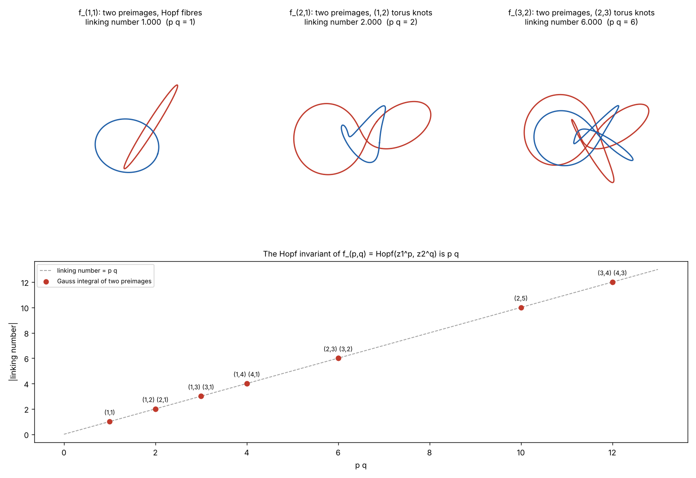
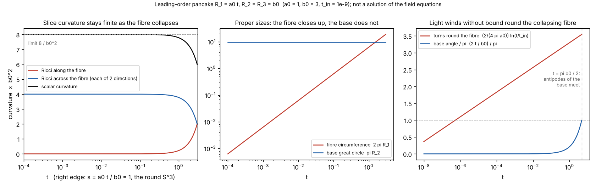
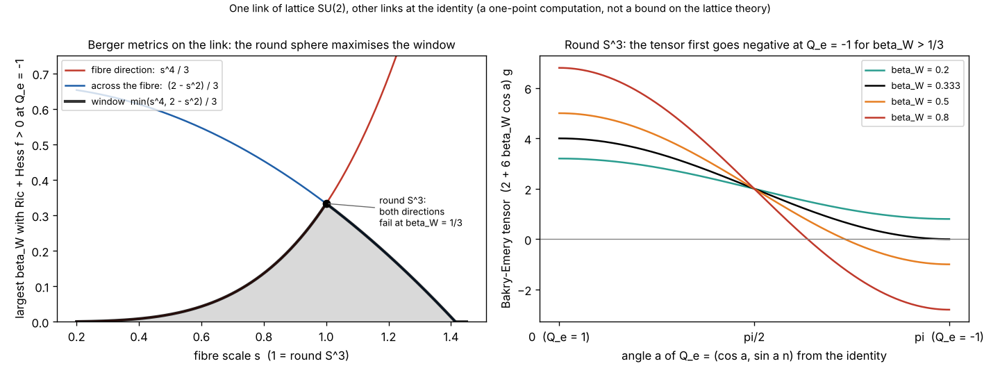

# HopfFibration

The Hopf fibration is the fibre bundle **S1 -> S3 -> S2**: the three-sphere **S3** (the unit sphere in R4 = C2) is a union of circles, one over each point of the two-sphere **S2**, and the Hopf map sends every point of a circle to that point of **S2**. Read it as "the fibre **S1** sits in the total space **S3**, which projects onto the base **S2**".

Under stereographic projection the fibres fill R3: every pair of fibres links once and no two meet. Circles of constant elevation on **S2** lift to nested tori, and a line of constant azimuth lifts to a Hopf band. At the poles of **S2** the picture degenerates: a flat circle in the X-Y plane at the south pole, and at the north pole a circle through infinity, drawn as the straight line along the Z axis.

## How this repo connects to other work

This fork is also a place to test how the fibration touches other repositories and papers. The links differ in strength, so each row says which kind it is. "Direct" means the same mathematical object; "indirect" means only a shared space (S3 = SU(2)); "topical" means the abstract was read and nothing more.

| Connection | What is shared | Scripts / notes here | Strength |
|---|---|---|---|
| **Pancake cosmology** (Dechant, Lasenby, Hobson, [arXiv:0809.4335](https://arxiv.org/abs/0809.4335)) via [Quantum_Gravity_Lab](#related-repositories) | the biaxial Bianchi IX slice is a Berger sphere whose short axis is the Hopf fibre | `hopf_berger.py`, `hopf_pancake.py`; in QGL: `qgl_hopf.py`, `tests/test_s3_identifications.py` | direct (biaxial case only), checked both ways, 18 of 18 |
| **Hopfion crystals** (Hou et al., [arXiv:2504.03981](https://arxiv.org/abs/2504.03981v1)) | the Hopf invariant as a linking number, Q_H = m n for xi = Z1^m / Z0^n | `hopf_knots.py` | direct, numerically checked for 12 coprime pairs |
| **Symbolic Hopf derivations** ([openai_math_yang_mills](#related-repositories)) | the Hopf map, Clifford relation, section circles, (p,q) knots | cross-check against `hopf_math.py` | direct, 23 of 23 |
| **Lattice Yang-Mills gap** (Bhattacharjee et al., Hexagon [2610.00341v5](https://hexagonmath.org/2610.00341v5)) | one SU(2) link lives on S3; Ricci curvature of the Hopf-squashed S3 | `hopf_be_window.py`, [`YANG_MILLS_LATTICE_GAP.md`](YANG_MILLS_LATTICE_GAP.md) | indirect; unrefereed preprint; one-point computation |
| Ferreira et al. ([2503.06315](https://arxiv.org/abs/2503.06315v2)), Lin et al. ([2406.06096](https://arxiv.org/abs/2406.06096)), Lisi ([2609.12112](https://arxiv.org/abs/2609.12112)) | the same S2 / hopfions / division algebras | see [References](#references) | indirect or topical |

*From the sister repository's `qgl_hopf.py`: the squashing of the Hopf fibre along the numerical pancake solution, which follows the leading-order line `a0 t / b0` near the pancake, then overshoots the round sphere (about 1.44) and falls back. The `hopf_pancake.py` figure below uses only the leading order.*

## Scripts

The scripts below use only numpy (and matplotlib/Pillow for pictures). Each has `--tests`; `python3 hopf_tests.py` runs them all.
Convention used throughout: a point of S3 is (z1, z2) in C2 with |z1|^2+|z2|^2 = 1, the Hopf map is
h = (2 Re z1 conj z2, 2 Im z1 conj z2, |z1|^2-|z2|^2), a fibre is e^{it}(z1, z2), and the stereographic projection is from (0,0,0,1).

| script | what it does |
|---|---|
| `hopf_math.py` | the exact core: map, fibres, stereographic projection, Gauss linking number, quaternion form, and an **audit of `makeFibre`** (below) |
| `hopf_clifford.py` | Clifford parallels (constant distance = half the base angle), left and right families, the Clifford torus and Villarceau circles |
| `hopf_s2_view.py` | the base S2 with one dot per fibre, in the colour `makeFibre` gives that fibre |
| `hopf_rotations.py` | the 12-fold rotation group of the Spectre tiling's 4D lift acting on C2: 60 degrees = the Hopf circle action, 30 degrees = a rotation by pi of the base |
| `hopf_berger.py` | Berger spheres (fibre scaled by s), exact Ricci curvature, the collapsing fibre (Mixmaster / "pancake"), and a labelled numerology check |
| `hopf_quaternion_rotor.py` | rotors, the SU(2)->SO(3) double cover, the qubit and Bloch sphere, Berry phase = half the solid angle |
| `hopf_line_bundle.py` | the Hopf fibration **without a principal bundle**: the tautological line bundle, connection and holonomy from the projector alone, three independent holonomy methods, Chern number 1 (see [`HOPF_WITHOUT_PRINCIPAL_BUNDLES.md`](HOPF_WITHOUT_PRINCIPAL_BUNDLES.md)) |
| `hopf_division_algebras.py` | the four Hopf fibrations S0->S1, S1->S3, S3->S7, S7->S15 from R, C, H, O by one formula; why the octonionic one is not a principal bundle |
| `hopf_anim.py` | GIF animations (a fibre sweeping a torus; a qubit rotating), and Blender keyframe helper |
| `hopf_knots.py` | the maps Hopf(z1^p, z2^q): preimages are (q,p) torus knots and two of them link p q times, the Hopf invariant (see [Connecting the pieces](#connecting-the-pieces-knots-the-pancake-and-one-su2-link)) |
| `hopf_pancake.py` | the collapsing fibre of the pancake cosmology on Berger slices: finite curvature, fibre circumference 2 pi R1, light winding round the fibre (leading order only, not a solution of the field equations) |
| `hopf_be_window.py` | the one-link Bakry-Emery tensor of lattice SU(2) at Q_e = -1 on round and Berger spheres: the 1/3 threshold, and why the round metric maximises the window |

### Audit of `makeFibre`

`hopf_math.py --tests` reproduces the circles that `fibration.py` builds, without Blender, and compares them with the exact
Hopf fibres. The exact fibre over elevation `ele` (halved, as in `makeFibre`) is a circle whose centre is at distance
`tan(ele)` from the z axis, with radius `sec(ele)`, in a plane tilted by `ele`. `fibration.py` has the correct tilt, the right
linking and the right overall picture, but uses a smooth approximation to `tan` and `sec`:

    baseRad  = 2*((1/(pi/2 - ele)) - (2/pi))            # approximates tan(ele)
    fibreRad = baseRad + 1/(baseRad + 1)                # approximates sec(ele)

so the circles are *close to* but not exactly Hopf fibres (for example r^2 - d^2 - 1 is 0.05 at elevation 0.6 and 0.69 at
2.5 instead of 0). Replacing the two lines by `baseRad = tan(ele)` and `fibreRad = 1/cos(ele)` makes every circle an exact
fibre, as the test checks (the picture is then the mirror image of the usual convention, which is also a Hopf fibration).
`fibration.py` itself is unchanged; the patch is for you to take or leave. Near the poles the circles get large (radius 14 at
elevation 3.0), so the cross-section `sectionRad` and the clipping distance may want adjusting.

### Notes on what the scripts do and do not claim

`hopf_rotations.py` and `hopf_berger.py` come from a study of the Spectre aperiodic monotile
([brentharts/spectre](https://github.com/brentharts/spectre), see `HOPF.md` and `CONNECTIONS.md` there). The 60-degree statement is
exact but elementary (any complex plane with a scalar phase action has it); the "6.0900 levels per turn is almost 6" is numerology,
asserted in the tests to miss 6. Nothing here claims the Hopf fibration explains the Spectre. The Blender helpers (`add_s2_to_blender`,
`keyframes_for_blender`) could not be run in the build environment (no Blender) and are untested.

The three scripts below are narrower than the pictures suggest. `hopf_knots.py` estimates linking numbers with a midpoint-rule Gauss
integral (a few parts in 10^3, rounded to the integer p q). `hopf_pancake.py` uses only the leading-order behaviour R_1 = a0 t,
R_2 = b0 near the pancake; it does not evolve any field equations or check the Dechant-Lasenby-Hobson solution (the sister repository's `qgl_hopf.py` follows
the numerical solution of its leading-order model, see [Related repositories](#related-repositories)). `hopf_be_window.py`
is a computation at one point (Q_e = -1) of one link with every other link at the identity; it is not a bound on lattice
Yang-Mills, and the Berger-metric question it asks is not addressed by the preprint it starts from. One fact about existing code:
`hopf_berger.berger_ricci` evaluates Milnor's formula, which subtracts numbers of size 1/s and loses all its digits once s is below
about 1e-6, so `hopf_pancake.py` uses the closed form (2 s^2, 4 - 2 s^2, 4 - 2 s^2), which `hopf_berger.py`'s tests already assert
equals Milnor's.

## Connecting the pieces: knots, the pancake, and one SU(2) link

Three scripts tie the fibration to the papers and repositories listed below. Each has `--tests` (run by `hopf_tests.py`) and
`--png`, which regenerates its figure.

### Torus knots and the Hopf invariant: `hopf_knots.py`

The map f_(p,q)(z1, z2) = Hopf(z1^p, z2^q), normalised back onto S3, has the Hopf fibration as its case p = q = 1. The preimage of a
point is a (q,p) torus knot, and the preimages of two points link p q times. The top row shows two preimages for (1,1) (the Hopf
link), (2,1) and (3,2) in the stereographic picture; the bottom plot compares the Gauss linking integral with p q for twelve
coprime pairs. The same product rule, Q_H = m n for the rational map xi = Z1^m / Z0^n, is the starting point of the hopfion crystals
of Hou et al. below, and the maps are also checked symbolically in the fork `openai_math_yang_mills`.

### The collapsing fibre: `hopf_pancake.py`

In a biaxial Bianchi IX universe the spatial slice is a Berger sphere: the Hopf fibre has scale R_1 and the base S2 has scale
R_2 = R_3. With the leading-order pancake behaviour R_1 = a0 t, R_2 = b0 (the form used in `Quantum_Gravity_Lab`), the left panel
shows the slice curvature staying finite as the fibre collapses (scalar curvature tends to 8 / b0^2 while the volume vanishes
linearly), the middle panel shows the fibre circumference 2 pi R_1 closing up against a base that does not, and the right panel
shows a null ray winding (2 / 4 pi a0) ln(t / t_in) times round the fibre, without bound as t_in tends to 0, while a ray across the
base reaches the antipode only at t = pi b0 / 2. The e-folds per fibre turn, 2 pi a0, are the clock behind
`hopf_berger.levels_per_turn`. The 4 pi period of the Euler angle that the winding count uses is checked in the tests.

### One SU(2) link and the 1/3 threshold: `hopf_be_window.py`

In lattice SU(2) a link variable lives on S3. With the other links at the identity, the weight exp(-f) has f = -6 beta_W Re Q_e, and
on the round unit S3 (Ricci 2) the Bakry-Emery tensor is (2 + 6 beta_W cos a) g, negative first at Q_e = -1 once beta_W exceeds 1/3
(right panel; this is the curvature statement in [`YANG_MILLS_LATTICE_GAP.md`](YANG_MILLS_LATTICE_GAP.md)). The question asked on
the left is whether squashing the Hopf fibre helps. At Q_e = -1, a critical point, the Hessian does not depend on the metric, so on
a Berger sphere the tensor is 2 s^2 - 6 beta_W / s^2 along the fibre and 4 - 2 s^2 - 6 beta_W across it, positive exactly for
beta_W < min(s^4, 2 - s^2) / 3. That window is largest at s = 1, where it equals 1/3: the round metric is optimal among Berger
metrics, so the threshold is not an artefact of choosing it.

## References

Papers and related reading. Each entry says how it relates to the Hopf fibration, so a loosely related paper is not mistaken for a direct source.

- L. A. Ferreira, A. Mikhaliuk, Ya. Shnir, *U(1) gauged non-topological solitons in the 3+1 dimensional O(3) sigma-model*,
  [arXiv:2503.06315v2](https://arxiv.org/abs/2503.06315v2) ([HTML](https://arxiv.org/html/2503.06315v2)).
  Gauged O(3) sigma-model solitons with a modified symmetry-breaking potential: they carry electric and magnetic fields (toroidal
  magnetic field, shell-like charge density) and angular momentum J = nQ. **Relation to this repo:** indirect. The paper does not
  discuss the Hopf map or fibration; it mentions Hopfions (classified by pi_3(S2)) only in its introduction and uses the CP^1
  formulation of the O(3) model, which is the same S2 as the base space of the Hopf fibration.
- W. Lin, N. Mata-Cervera, Y. Ota, Y. Shen, S. Iwamoto, *Space-Time Hopfion Crystals*,
  [arXiv:2406.06096](https://arxiv.org/abs/2406.06096) (v1, June 2024; DOI 10.1103/hh5s-cprt).
  Proposes crystalline lattices of hopfions in space-time, built from spatiotemporally structured light (bichromatic beams or
  dipole arrays), with tunable topological order. **Relation to this repo:** indirect. Hopfions are textures classified by the Hopf
  map, but the abstract page does not discuss the fibration itself; check the full text before citing a specific construction.
- W.-T. Hou, Z. Xiang, Y. Liu, J. Zang, *Construction of Hopfion Crystals*,
  [arXiv:2504.03981v1](https://arxiv.org/abs/2504.03981v1) ([HTML](https://arxiv.org/html/2504.03981v1)), cond-mat.str-el, April 2025.
  Builds cubic hopfion crystals (simple, face-centered and body-centered) by composing the maps R3 -> S3 (stereographic
  projection), S3 -> S2 (the Hopf map, via the rational map xi = Z1/Z0) and S2 (stereographic projection from C). The Hopf index is
  the linking number of preimages; the S3 point is a superposition of three helical waves plus a constant c in R4, and the index
  depends on c (Q_H = 2 for |c| < 1, -1 for 1 < |c| < 3, 0 for |c| > 3). Using xi = Z1^m / Z0^n gives (m,n) torus structures with
  Q_H = mn, plus torus links and a trefoil knot. **Relation to this repo:** direct. It is the Hopf map S3 -> S2 and the linking
  number of fibres that `hopf_math.py` computes, applied to build lattices.
- D. Bhattacharjee, U. Bhattacharya, J. M. Lockwood, T. Romanov, *Explicit lattice Yang-Mills mass gap for every compact simple
  group reducing the continuum gap to one cube*, Hexagon preprint
  [2610.00341v5](https://hexagonmath.org/2610.00341v5) (31 Oct 2026; not on arXiv, not peer reviewed; the site now lists a v6 under
  the title *Yang-Mills Mass Gap on the Lattice and One Cube from the Continuum*).
  Claims a unique infinite-volume state and an explicit transfer-matrix gap for 4D lattice Yang-Mills theory with any compact
  simple gauge group, up to stated coupling bounds for SU(2) and SU(3), plus a reduction of the continuum gap to a condition on one
  cube. The authors state that this does not solve the Clay Millennium problem. Companion code: a
  [Lean 4 formalization](https://github.com/creelie/4Y-M/blob/main/YangMills/StrongCoupling/GaugeFix.lean) and a
  [forest-certificate repository](https://github.com/romanov360/yang-mills-4d-forest-certificate).
  **Relation to this repo:** indirect, through SU(2). The SU(2) proofs identify the group with the unit quaternions, i.e. the
  three-sphere S3 that is the total space of the Hopf fibration, and use the von Mises-Fisher law on S3 and its Ricci curvature
  (see `hopf_berger.py` and `hopf_quaternion_rotor.py` for the same S3 and SU(2)->SO(3) objects). The word "Hopf" does not occur in
  the 150-page text. Notes on it: [`YANG_MILLS_LATTICE_GAP.md`](YANG_MILLS_LATTICE_GAP.md).
- A. Garrett Lisi, *Division Algebras, Triality, and Exceptional Magic*,
  [arXiv:2609.12112](https://arxiv.org/abs/2609.12112) (math-ph, cross-listed hep-th; v1 listed 10 Sep 2026, though the comments
  field says it was originally submitted to arXiv on 24 April 2025), *Adv. Appl. Clifford Algebras* 36, 45 (2026),
  DOI [10.1007/s00006-026-01447-5](https://doi.org/10.1007/s00006-026-01447-5).
  Explains how division algebras, split composition algebras, triality, Clifford algebras, spinors and the exceptional magic square
  Lie algebras are related, including 3-symmetric spaces, Vinberg theta algebras and exceptional unification in particle physics.
  **Relation to this repo:** topical, from the abstract page only (the full text was not read). The abstract does not mention the
  Hopf fibration, S3 or S2, but division algebras are the algebraic source of the four Hopf fibrations that
  `hopf_division_algebras.py` builds from R, C, H, O, and its spinor and Clifford-algebra material sits next to
  `hopf_quaternion_rotor.py`. Check the full text before citing a specific construction.

## Related repositories

- [brentharts/openai_math_yang_mills](https://github.com/brentharts/openai_math_yang_mills): a fork of OpenAI's math manuscript
  release (721 manuscripts) that carries its own fork-level notes; those notes are not part of OpenAI's release. It is large
  (about 3.7 GB). Three parts relate to this repo:
  - `HOPF_GAUGE.md` and `sympy_models/models/hopf_fibration.py` re-derive the Hopf-map facts used here in exact symbolic algebra
    (no code copied: this repo is GPL-2.0, the fork Apache-2.0). It pins this repo at an older commit, `bd099a6`.
  - `YM_CONNECTIONS.md` and `forest_gauge_4d.py` build on the Bhattacharjee et al. forest gauge; see
    [`YANG_MILLS_LATTICE_GAP.md`](YANG_MILLS_LATTICE_GAP.md), section 8, for how the numbers line up.
  - Its notes are explicit that nothing Hopf-related bears on a Yang-Mills existence or mass-gap result. The only shared fact is
    S3 = SU(2). This repo makes the same point.

  

<b>Cross-check (3 Nov 2026): 23 of 23 pass</b>

  The fork's Hopf claims were restated from its docstring and tested numerically against
  `hopf_math.py` (the fork's own code was not run): 23 of 23 checks pass.
  - The map, fibre constancy, and the Clifford relation |<z,w>|^2 = (1 + h(z).h(w))/2, with fibre distance equal to half the
    base angle.
  - h*sigma = -2 dA in Hopf coordinates, by finite differences through `hopf_math.hopf`.
  - The section formulas: `section(base_point(el, az))` is (sin(el/2), cos(el/2) e^(-i az)), and the stereographic image of
    latitude `el` is the circle of centre (1/s, 0) and radius c/s (s = sin(el/2), c = cos(el/2)). Every fibre over that latitude
    lies on the torus of revolution of this circle, and is one of its Villarceau circles (radius 1/s, centre c/s from the axis).
    That equals the exact (sec, tan) circle of the `makeFibre` audit above at ele' = (pi - el)/2.
  - The maps f_(p,q) = Hopf(z1^p, z2^q), normalised: preimages are (q,p) torus knots, and two of them have Gauss linking number
    pq for (p,q) = (1,1), (2,1), (1,3), (3,2), (2,5), (3,4). This is the same product rule as Q_H = mn for xi = Z1^m / Z0^n in
    Hou et al. above.
  - Convention: quantum-lattice's conj(z1) z2 is the reflection y -> -y of `hopf_math.hopf`.

  Not covered: the fork's other models, and anything it states beyond its Hopf-fibration model. The check script is not in this
  repo.

  

- [brentharts/Quantum_Gravity_Lab](https://github.com/brentharts/Quantum_Gravity_Lab) (CC0-1.0, about 4 MB): a semi-classical
  sandbox that couples orbits, a Jaynes-Cummings sensor and a "complexity scalar". Its cosmology modules are the part that touches
  this repo: `qgl_bkl.py` (BKL / Mixmaster, vacuum Bianchi IX), `qgl_pancake.py` (the non-singular pancake of Dechant, Lasenby and
  Hobson, [arXiv:0809.4335](https://arxiv.org/abs/0809.4335)) and `qgl_horizon.py` (particle horizons). The spatial slices there
  are S3 with three scale factors; when two are equal the slice is a Berger sphere and the unequal axis is the Hopf fibre, which is
  the setting of `hopf_berger.py` (that script already cites the pancake model). Only the biaxial case is Hopf; general Mixmaster
  has three unequal axes.

  

<b>Cross-check (3 Nov 2026): 18 of 18 pass</b>

  The geometry its modules rely on was re-implemented from their source text and tested numerically
  against `hopf_berger.py` and `hopf_math.py` (their code was not run): 18 of 18 checks pass.
  - `qgl_bkl.ricci3(a)` with a = R/2 equals Milnor's Ricci curvature of the metric (1/4) sum R_i^2 omega_i^2 on S3, in the
    orthonormal frame, for random scale factors (constant ratio 1.000000), so the unit S3 is R_i = 1.
  - For R = (s, 1, 1) it gives Ricci (2 s^2, 4 - 2 s^2, 4 - 2 s^2) and scalar 8 - 2 s^2, the same as `hopf_berger.berger_ricci`.
  - The pancake limit: for R = (1e-6 b, b, b) with b = 1, 3 and 18000 (the paper's value), the spatial scalar curvature is 8/b^2
    and the Ricci curvature along the fibre goes to 0. The fibre collapses while the slice curvature stays finite.
  - The Euler-angle S3 pulls back to (1/4)(d theta^2 + d phi^2 + d psi^2 + 2 cos theta d phi d psi), the psi-orbit is a Hopf
    fibre, and the point returns at psi = 4 pi (psi = 2 pi is the antipode). The fibre length is therefore 2 pi R_1, and the base
    point's polar angle is theta, with antipodes at pi and base radius R_2 / 2. These are the identifications behind
    `FIBRE_PERIOD = 4 pi`, `fibre_circumference = 2 pi R_1` and the null rates 2 / R_1 and 2 / R_2 in `qgl_horizon.py`, which
    that file marked as "not checked". They hold for the standard S3; whether the paper uses that S3 and not an SO(3) quotient is
    not tested here (period 2 pi there would double every winding count). The Euler-angle and Milnor parts of this check now live in
    the QGL repository as `tests/test_s3_identifications.py` (13 tests), written independently of this repo's code.
  - The volume of the (s, 1, 1) slice is 2 pi^2 s.

  Not covered: the dynamics (the bounce solver, K(t), the horizon integrals), and everything physical (the sensor, the complexity
  scalar, the Bell-parameter ansatz). The repository states that its coupling from curvature to the sensor is a modelling choice,
  and that its Mixmaster horizon test is a proxy not checked against real null geodesics. This repo takes no position on either.

  

  *Added in QGL after the cross-check.* `qgl_hopf.py` follows the Berger-sphere reading along the real numerical pancake solution
  rather than its leading order, and `tests/test_hopf.py` checks it (11 tests). Its README has a matching subsection, "The pancake
  as a Hopf fibration". Two things come out that the leading-order scripts here cannot show. For a0 = 1, b0 = 3, f0 = 2, m = 0.5 the
  squashing s = R_1 / R_2 follows a0 t / b0 near the pancake, then overshoots the round sphere (peak about 1.44 near t = 3.7) and
  falls back, so the slice does not approach a round S3 monotonically. And the e-folds of t per fibre turn, 2 pi R_1 / t, start at
  2 pi a0 and rise to about 8.7 before falling, so the constant 2 pi a0 used in `hopf_berger.levels_per_turn` is the small-t value
  only. The slice Ricci curvature from the solution equals the Berger closed form to rounding, which checks `qgl_bkl.ricci3` and
  the identification, not new physics.
